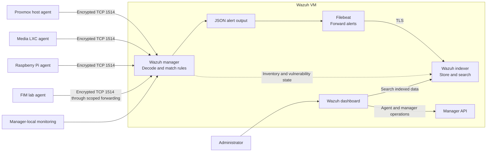

# Wazuh Security Monitoring Homelab

**Endpoint visibility · Security event analysis · File integrity monitoring · Incident investigation**

A documented Wazuh deployment running in Proxmox VE, with agents monitoring the hypervisor, a media container, a Raspberry Pi, and a dedicated FIM lab endpoint. This project explains how telemetry becomes searchable security alerts and how to operate and investigate the platform.

Collection, analysis, and indexing continue while the dashboard is closed. Daily dashboard use is independent of the background monitoring workload.

## Deployment at a glance

Verified on **November 24, 2026**.

| Area | Observed state |
| --- | --- |
| Platform | Proxmox VE with a dedicated Wazuh VM |
| VM allocation | 4 CPU cores, 8 GiB RAM, 40 GiB virtual disk |
| Wazuh manager / indexer / dashboard | 4.14.8; all three services active |
| Filebeat | 7.10.2; service active and output connection test passed |
| Remote agents | 4 connected agents after the FIM project |
| Manager-local source | Active local monitoring, listed separately from remote agents |
| Indexer | One node, green health, zero unassigned shards |
| Alert storage | 49 alert indices with 81,890 indexed documents at inspection |
| Index lifecycle | No assigned ISM policy on the 49 inspected alert indices |

The alert storage counts describe the initial inspection snapshot. The agent count includes the subsequently completed FIM project. [Validation and limitations](docs/validation.md) records how they were checked.

## Completed detection project

The [File Integrity Monitoring Lab](https://github.com/J0N3B0I/Wazuh-FIM-Lab) is complete. A dedicated Ubuntu VM produced verified creation, modification, and deletion alerts through both the manager and indexer, with matching hashes and targeted network-boundary checks. Read the [project summary](https://github.com/J0N3B0I/Wazuh-FIM-Lab/blob/main/SUMMARY.md) for its implementation and measured results.

## How the platform works

An agent collects configured endpoint telemetry. The manager decodes events, applies rules, and writes qualifying alerts. Filebeat forwards alert data to the indexer. The dashboard brings indexed evidence and manager information together for investigation. Inventory and vulnerability state also use the manager's indexer integration. [Official architecture](https://documentation.wazuh.com/current/getting-started/architecture.html)

## What this lab currently monitors

The inspected Proxmox and media-container agents collect journald events, package-manager logs, inventory, file integrity data, and security configuration assessments. Their file checks run at startup and every 12 hours. Inventory collection runs hourly, and configuration assessments run at startup and every 12 hours.

The manager also monitors its own system. Vulnerability detection and its indexer connector are enabled in the inspected manager configuration. A recent bounded alert sample contained file-integrity, rootcheck, package-change, and AppArmor-related groups.

The Raspberry Pi's connection was verified from the manager. Its endpoint configuration requires a separate inspection. Host/container agent installation provides coverage of configured host data sources. Application-specific Docker logs and container runtime auditing require their own collection configuration.

## Read the project

| Guide | What it explains |
| --- | --- |
| [Architecture](docs/architecture.md) | Component responsibilities, trust boundaries, and data paths |
| [Deployment process](docs/deployment.md) | Infrastructure, installation, enrollment, and verification sequence |
| [Detection and investigation](docs/detection-and-investigation.md) | Collection, decoding, rule matching, searching, and triage |
| [Operations](docs/operations.md) | Service checks, troubleshooting, resources, upgrades, and recovery |
| [Validation record](docs/validation.md) | Live findings, evidence scope, and unresolved items |
| [Project roadmap](docs/project-roadmap.md) | Practical detection exercises and their completion criteria |

## Resource planning

The VM's 8 GiB allocation supports the manager, indexer, dashboard, and supporting processes. Its earlier memory inspection showed approximately 3.2 GiB used by applications/system activity and 4.4 GiB in filesystem cache, with about 4.6 GiB available inside the guest. Cache is reclaimable, so a high host-side VM allocation does not establish application memory exhaustion.

Wazuh's all-in-one quickstart recommends 8 GiB RAM and 4 vCPU for a small deployment. The VM currently has a 40 GiB virtual disk, compared with the guide's 50 GB storage reference for 1–25 agents and 90 days of data. Retention and growth need deliberate review. [Official sizing guidance](https://documentation.wazuh.com/current/quickstart.html)

## Operational priorities

- Review alert noise before adding custom detections.
- Review retention and index growth. None of the 49 inspected alert indices has an assigned ISM policy.
- Establish sufficient backup storage and perform an isolated restore test. Backup changes are currently deferred by the owner while additional storage is being obtained.
- Develop detection exercises in a dedicated lab guest and publish sanitized evidence after testing.

## Related project

The wider homelab documentation covers Proxmox, the Docker media stack, storage maintenance, and backup incidents. [Proxmox homelab](https://github.com/J0N3B0I/Proxmox-homelab)
